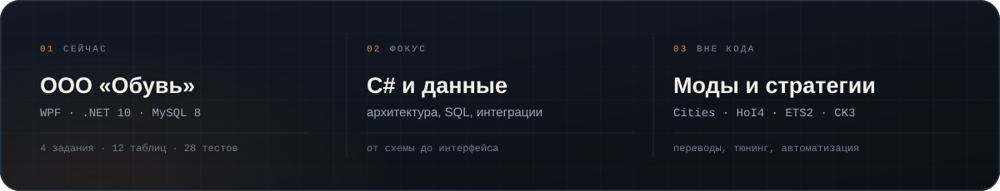
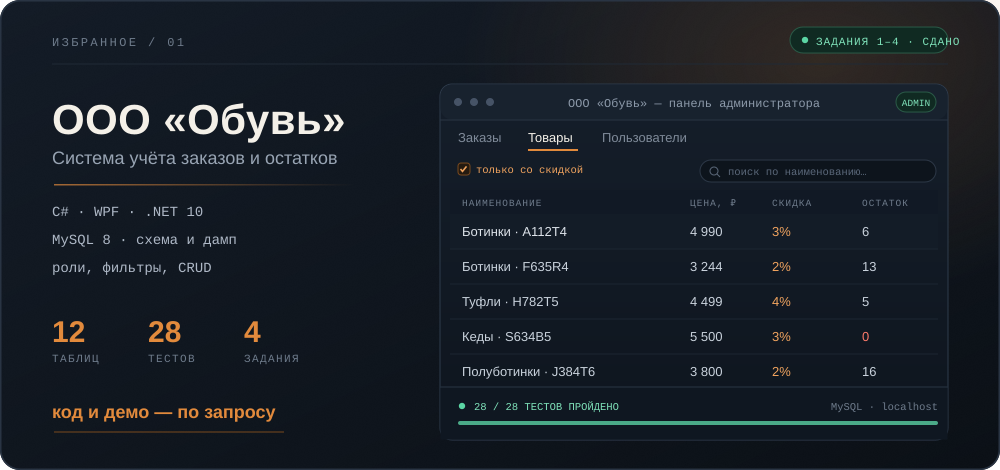
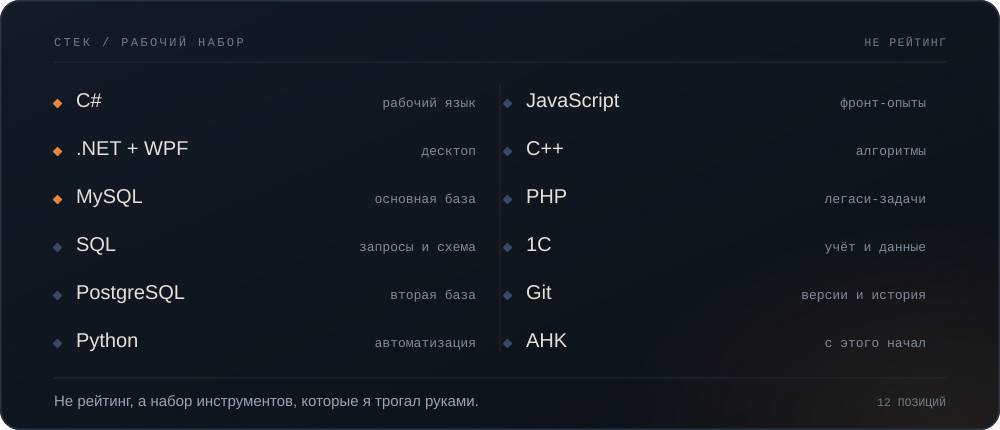
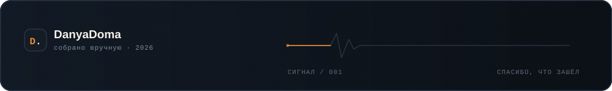

  

  <a href="#сейчас"><kbd>сейчас</kbd></a>&nbsp;
  <a href="#избранное"><kbd>избранное</kbd></a>&nbsp;
  <a href="#стек"><kbd>стек</kbd></a>&nbsp;
  <a href="#путь"><kbd>путь</kbd></a>&nbsp;
  <a href="#дневник"><kbd>дневник</kbd></a>&nbsp;
  <a href="#контакты"><kbd>контакты</kbd></a>

## Сейчас

## Избранное

  <a href="https://github.com/DanyaDoma/ooo-obuv-magazin-obuvi">репозиторий</a> ·
  <a href="https://github.com/DanyaDoma/ooo-obuv-magazin-obuvi/blob/main/db/dump/shoe_store.sql">дамп базы</a> ·
  <a href="https://github.com/DanyaDoma/ooo-obuv-magazin-obuvi/tree/main/docs">документация</a>

## Стек

## Путь

## Дневник

То, что не попадает в коммиты: игры, переводы и наблюдения с конференций.

<b>Моды, которые я переводил</b> — 4 жанра, 10+ игр

 

| Стратегии | Гранд-стратегии | Симуляторы | Другие жанры |
|:---|:---|:---|:---|
| Civilization VI | Hearts of Iron IV | Euro Truck Simulator 2 | Payday 2 |
| Cities: Skylines | Crusader Kings III | ARK: Survival Evolved | Space Engineers |
| Tropico | Europa Universalis IV | | |
| | Stellaris | | |

Переводил интерфейсы, правил тексты и собирал локализации. Лучший тренажёр внимательности: одна пропущенная строка — и мод ломается.

<b>Конференции 2025</b> — что я вынес

 

| Мероприятие | Организатор | Формат |
|:---|:---|:---|
| IT Talk | Сбер | Митап |
| Kaspersky Industrial Cybersecurity Conference | Лаборатория Касперского | Конференция |
| South HUB | IT-сообщество | Кэмп-конференция |

> Многие IT-мероприятия превратились в **театр формальностей**, где важнее пиджак спикера, чем содержание его доклада.

Ценность — в неформальных разговорах, знания — у практиков, инсайты — в обсуждениях после докладов.

> Учусь каждый день. Проверяю, а не верю. Делаю проекты, а не коллекционирую сертификаты. Делюсь тем, что понял.

## Контакты

  &nbsp;
  <a href="https://t.me/DanyaDoma">Telegram</a>&nbsp;&nbsp;·&nbsp;&nbsp;
  &nbsp;
  <a href="https://www.youtube.com/@foreve4711">YouTube</a>&nbsp;&nbsp;·&nbsp;&nbsp;
  &nbsp;
  <a href="https://github.com/DanyaDoma">GitHub</a>

Не нажимай

 

Ты нажал. Уважаю. Первый код был на AHK — макрос для игры. С него всё началось, и обратно я не вернулся.

